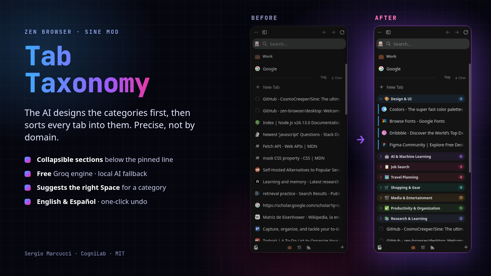

# Tab Taxonomy

**Ordena tus pestañas en Zen Browser con IA precisa.** Tab Taxonomy lee todas las pestañas del Space y **primero diseña una taxonomía**: categorías con nombre, y cada una con un alcance claro de qué entra y qué no. Después clasifica cada pestaña en secciones plegables de colores, debajo de la línea de las fijadas. Funciona como el *Tidy Tabs* de Arc, pero agrupa por **lo que estás haciendo**, no por el sitio web.

[English](README.md)

## ¿Qué lo hace distinto?

1. **Taxonomía.** El modelo ve todas las pestañas a la vez y propone de 4 a 8 categorías. Cada una trae una frase de *alcance*, por ejemplo: «Edición en DaVinci: tutoriales, plugins, LUTs. No incluye música ni stock». Las categorías vagas («Varios», «Herramientas», «Recursos») se descartan.
2. **Clasificación.** Las pestañas se clasifican en bloques pequeños según esos alcances. El esquema JSON exige una respuesta por pestaña, así que ninguna se pierde ni se desalinea. Si queda mucho sin clasificar, una segunda pasada diseña las categorías que faltaban.

En sesiones reales de 100 a 140 pestañas, ordenar tarda entre 5 y 20 segundos.

## Uso

| Acción | Cómo |
|---|---|
| Ordenar lo nuevo | Botón **Ordenar** en la línea divisoria (aparece al pasar el mouse) · `Ctrl+Alt+O` · clic derecho en una pestaña o en el Space |
| Reordenar todo el Space | `Shift`+clic en **Ordenar** · clic derecho → «Reordenar todo el Space» |
| Plegar / renombrar | Clic / doble clic en la cabecera |
| Mover la categoría a otro Space | Clic en el chip «→ Space» o clic derecho en la cabecera |
| Cambiar una pestaña de categoría | Arrastrarla, o clic derecho → «Mover a categoría» |
| Deshacer | Clic derecho → «Deshacer último orden» |

## Motores

1. **Groq**, gratis: `gpt-oss-120b`, que rota a `gpt-oss-20b` o `qwen3.8-27b` si se agota el cupo. Necesitas una clave gratuita de [console.groq.com/keys](https://console.groq.com/keys).
2. **La IA local de Zen** (ONNX): se usa si Groq falla o no hay clave. Nombra las categorías en inglés y de forma más genérica.
3. **Por dominio**: el último recurso.

**Privacidad:** a Groq solo se envían **títulos y dominios**, nunca el contenido de las páginas. Si dejas la clave vacía, nada sale de tu equipo.

## Instalación

1. Instala [Sine](https://github.com/CosmoCreeper/Sine).
2. En Zen ve a **Ajustes → Sine Mods → Marketplace**, busca **Tab Taxonomy** e instálalo. Mientras aparece en la tienda, pega `https://github.com/Sergoiip/zen-tab-taxonomy` en la opción de instalar desde un repositorio.
3. En los ajustes del mod, pega tu **clave de Groq**.
4. Pasa el mouse por la barra lateral y pulsa **Ordenar**, o usa `Ctrl+Alt+O`.

En Linux: `scripts/install-linux.sh` instala Sine (versión oficial, verificada por checksum) y el mod.

## Licencia

MIT © 2026 [Sergio Marcucci · CogniLab](https://cognilab.org)
