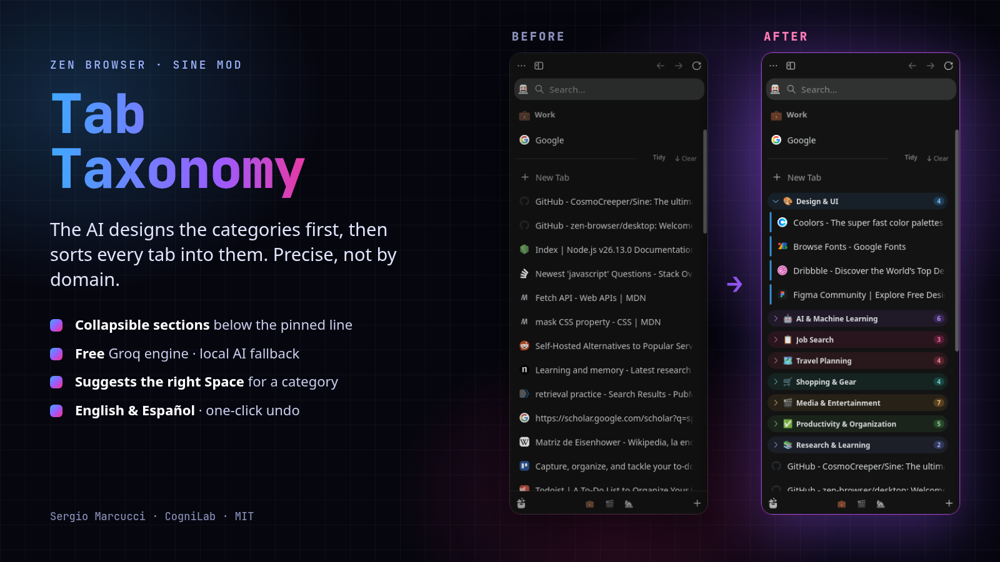

# Tab Taxonomy

**Precise AI tidy for Zen Browser.** Tab Taxonomy reads every tab in your Space, **designs a taxonomy first** (named categories, each with a clear scope of what belongs and what doesn't), and then sorts each tab into collapsible, colored sections below the pinned line. It works like Arc's *Tidy Tabs*, but it groups by **what you're doing**, not by which website the tab is on.



[Español](README.es.md)

## Why another tab sorter?

Most sorters cluster by domain, or ask a model to label tabs one by one. Tab Taxonomy works in two steps:

1. **Taxonomy.** The model sees all the tabs at once and proposes 4–8 categories. Each one gets a one-sentence *scope* (for example, “Video editing in DaVinci: tutorials, plugins, LUTs. Not music or stock footage.”). Vague buckets such as *Misc*, *Tools* or *Resources* are rejected.
2. **Sorting.** Tabs are classified in small batches against those scopes. The JSON schema requires one answer per tab, so no tab gets lost or misaligned. If too many tabs are left over, a second pass designs the missing categories.

Tested on real sessions of 100–140 tabs, a tidy takes about 5–20 seconds.

## Features

- **Tidy** button on the pinned divider (it appears when you hover the sidebar, like Zen's *Clear*), **Ctrl+Alt+O**, or right-click a tab or a Space.
- **Tidy new tabs** sorts only the loose tabs and reuses your existing categories. **Re-tidy the whole Space** starts over.
- Categories are **collapsible**, colored and counted. They stay **below the pinned line** (they never become pinned folders) and survive restarts.
- **Space suggestions:** if a whole category clearly belongs to another Space, a “→ 🎬 Video” chip appears. One click moves it there; nothing moves on its own.
- **Editing by hand:** double-click a header to rename it, drag a tab between groups to change its category, or right-click to move a category to another Space, ungroup it, unload its tabs or close them.
- **One-click undo** of the last tidy.
- **English and Spanish.** The interface and the category names follow your browser language, or you can choose one in the settings.

## Engines

| Order | Engine | Cost | Notes |
|---|---|---|---|
| 1 | **Groq** (`gpt-oss-120b`, rotating to `gpt-oss-20b` / `qwen3.8-27b` when rate-limited) | Free tier | Best precision. Needs a free key from [console.groq.com/keys](https://console.groq.com/keys). |
| 2 | **Zen's local AI** (Firefox Smart Tab Grouping, ONNX) | Free, on-device | Used if Groq fails or there's no key. Downloads ~60 MB once; labels are English-only and more generic. |
| 3 | **By domain** | Free | Last resort; always works. |

**Privacy:** only tab **titles and domains** are sent to Groq, never page contents, cookies or history. With the Groq key left empty, nothing leaves your machine.

## Install

1. Install [Sine](https://github.com/CosmoCreeper/Sine), the mod manager that runs JS mods in Zen.
2. In Zen, open **Settings → Sine Mods → Marketplace**, search **Tab Taxonomy** and install it. (Before it's listed, paste `https://github.com/Sergoiip/zen-tab-taxonomy` into Sine's *install from repo* field.)
3. Open the mod's settings and paste your **Groq API key**.
4. Hover the sidebar and click **Tidy**, or press **Ctrl+Alt+O**.

Linux helper (installs Sine from its official, checksum-verified release, plus this mod):

```bash
git clone https://github.com/Sergoiip/zen-tab-taxonomy && cd zen-tab-taxonomy
scripts/install-linux.sh            # close Zen first; asks for sudo once
scripts/install-linux.sh --mod-only # update just the mod
```

## Settings

| Setting | Default |
|---|---|
| Groq API key, or a file containing `GROQ_API_KEY=` | — |
| Model | `openai/gpt-oss-120b` |
| Language | same as the browser |
| Local-AI fallback | on |
| Suggest moving categories to other Spaces | on |
| Where categories go | below new tabs (or right under the pinned line) |
| Max categories per tidy | 8 |
| Shortcut | `ctrl+alt+o` |

## Notes

- The **Tidy** button only shows when the Space has at least one pinned tab, because Zen hides the divider otherwise. The shortcut and the context menus always work.
- Built and tested on Zen 1.24b (Firefox 159) with Sine 2.3.3.
- Built with AI assistance (`"ai": "yes"` in `theme.json`) and reviewed and tested on real sessions.

## License

MIT © 2026 [Sergio Marcucci · CogniLab](https://cognilab.org)
